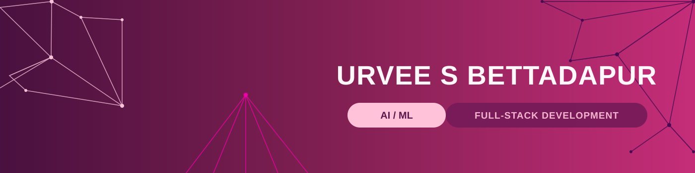
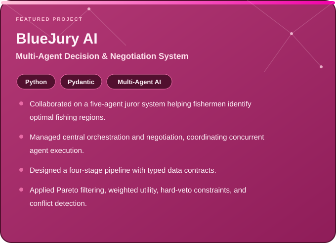
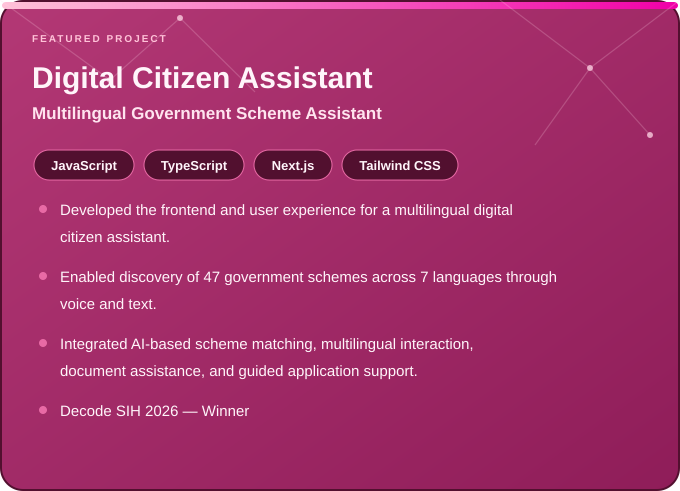
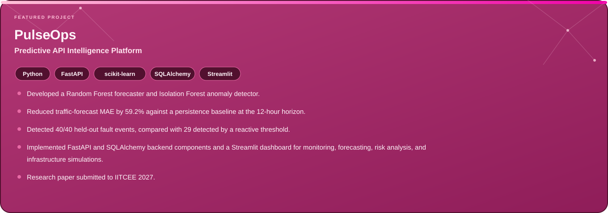
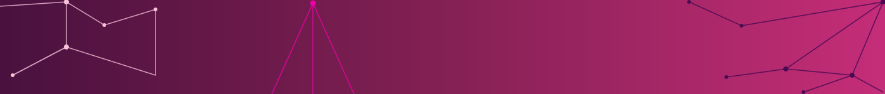

 

# Hey, Urvee here. 😎

### Developer | AI/ML Enthusiast | Problem Solver

I'm a developer driven by curiosity, ambition, and the pursuit of excellence. I enjoy tackling challenging problems, exploring emerging technologies, and turning ideas into practical solutions.

**Currently exploring:** AI/ML · Full-Stack Development · RAG · Multi-Agent Systems

---

<h2 align="center">🛠️ TECH STACK</h2>

### 💻 Programming Languages

  

### 🌐 Web Development & Backend

  
  
  

### 🤖 AI, Machine Learning & Data

  
  
  
  
  
  

### 🗄️ Database & Tools

  
  
  

---
## 🚀 FEATURED PROJECTS

<table>
<tr>
<td width="50%" valign="top">
  
</td>
<td width="50%" valign="top">
  
</td>
</tr>
<tr>
<td colspan="2">
  
</td>
</tr>
</table>

<h2 align="center">📜 CERTIFICATIONS</h2>

  
  
  
  

---

## 📈 GITHUB STATISTICS

  
  

  

---

<h2 align="center">🔗 CONNECT WITH ME</h2>

  
  &nbsp;&nbsp;&nbsp;
  
  &nbsp;&nbsp;&nbsp;
  

  <i>Always learning. Always evolving. Always aiming higher.</i>

  

